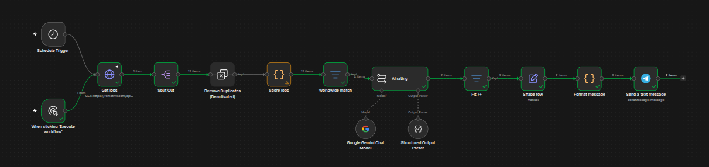

# Remote job scout (n8n + AI)

Every morning this n8n workflow fetches new remote software jobs,
scores each one against my skills with an LLM, and sends me the
best matches.

## What it does
1. Schedule trigger runs daily at 08:00
2. HTTP Request pulls jobs from the Remotive API
3. Split Out turns the response into one item per job
4. Remove Duplicates skips jobs already seen
5. Code node cleans the data and scores keyword matches
6. Filter keeps worldwide roles that match my stack
7. LLM rates each job 1-10 with a reason (structured JSON output)
8. Jobs rated 7+ are sent to Telegram

## Tech
n8n, JavaScript (Code node), Ollama / Gemini, Telegram Bot API

## Run it yourself
1. Import `Job-scout.json` into n8n
2. Add your own model and Telegram credentials
3. Edit the keyword list and prompt to match your skills

